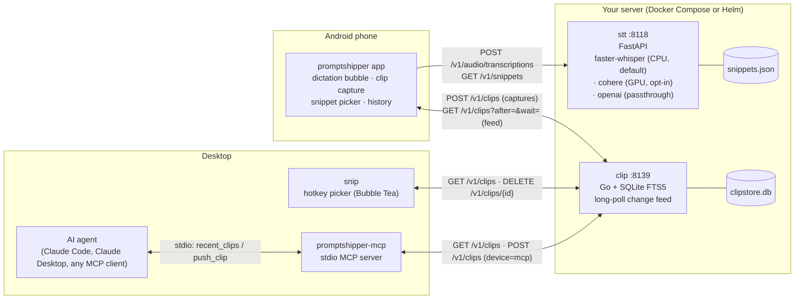
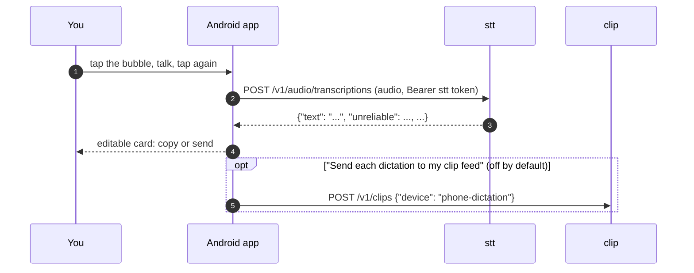
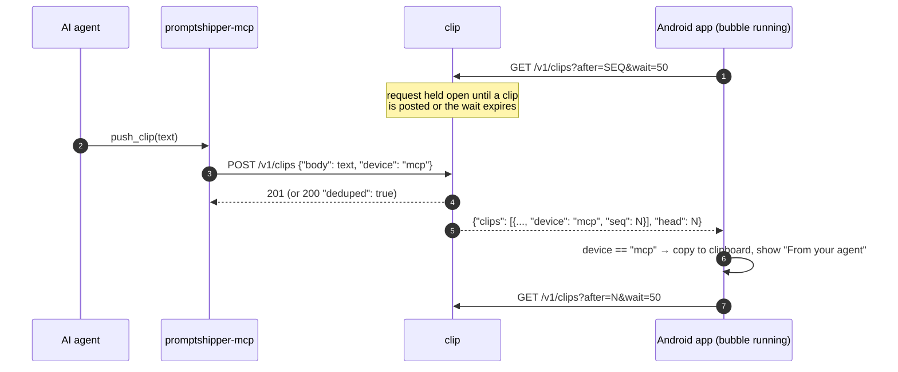

# Architecture

promptshipper is two small HTTP services you run yourself, plus the clients that
talk to them. Nothing in the stack calls a hosted service of ours; there is
none.

## Components

Every arrow to `stt` or `clip` is plain HTTP with a bearer token, over a
private network you control (a Tailscale tailnet, your LAN, a VPN). Each server
has its own token; `GET /healthz` is the only unauthenticated route on either.

| component | code | role |
|---|---|---|
| STT server | [`server/stt`](../server/stt/README.md) | OpenAI-compatible `POST /v1/audio/transcriptions` with a pluggable backend, and `GET /v1/snippets`, the canned-prompt catalog. Keeps no audio and no transcript history |
| clip server | [`server/clip`](../server/clip/README.md) | the cross-device clipboard: one SQLite file with a full-text index, newest-first list, search, delete, and a long-poll change feed |
| MCP server | [`server/mcp`](../server/mcp/README.md) | a stdio MCP server; two tools, `recent_clips` (read) and `push_clip` (write, always as device `mcp`). Stores nothing |
| snip | [`desktop/snip`](../desktop/snip/README.md) | hotkey → fuzzy snippet picker → paste; `ctrl+g` lists the shared clipboard |
| Android app | [`android`](../android/README.md) | floating dictation bubble, text capture to the clip server (share sheet and the text-selection menu), snippet picker, dictation history, QR pairing, auto-copy of agent pushes |

## Dictation: phone → STT

The server writes the upload to a temporary file, decodes and transcribes it,
and deletes it. If the phone is not paired, or the server cannot be reached,
the app falls back to the phone's own speech recognizer.

## Agent → phone: the long-poll push

- Only clips whose `device` is exactly `mcp` are copied automatically. Text
  captured on your other devices appears in the clip list but is never copied
  unasked.
- The app polls only while its bubble is running, and stops five minutes after
  the screen goes off; it holds no wake lock. A push made while it is not
  polling waits at the top of the clip list, and when polling resumes only the
  newest `mcp` clip of the backlog is copied.
- Long-poll rather than SSE or WebSockets: one ordinary request per poll
  survives flaky mobile networks and a suspended foreground service with no
  reconnection protocol. The full contract (`seq`, `head`, resync, limits) is in
  [`server/clip/README.md`](../server/clip/README.md#change-feed-long-poll).

## Agent ← phone/desktop: reading clips

An agent calls `recent_clips` to see what you just highlighted, shared or
copied. The MCP server fetches the newest clips, redacts the clip server's own
token from every body, and filters by your query **locally** — the query is
never sent to the clip server (see
[`server/mcp/README.md`](../server/mcp/README.md#what-is-and-is-not-protected)
for why).

## Pairing

`./setup` generates both tokens and prints a QR code holding a small JSON
payload: both server URLs and both tokens. The phone scans it (through any
installed QR scanner app, or by pasting the text). Desktop tools get a
clip-only code from `./setup --pairing --for desktop`, so the STT token stays
on the phone. Format: [`docs/pairing.md`](pairing.md).
